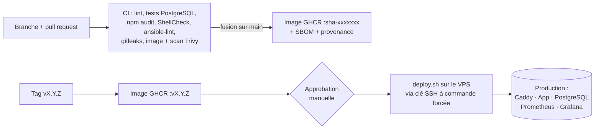
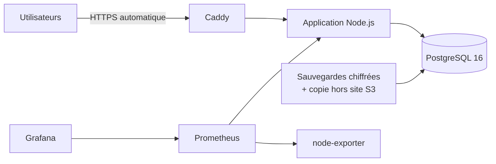

# Multipressing — chaîne DevOps

[](https://github.com/Malick-ALGawth/multipressing-devops/actions/workflows/verification.yml)

Vitrine publique de l'**infrastructure et de la chaîne CI/CD** de *Multipressing*, une application web de gestion d'un réseau de pressings (tickets, caisses, paiements mobiles Wave / Orange Money, tableaux de bord par boutique).

> Le code applicatif (Node.js/Express, PostgreSQL) et les intégrations de paiement restent dans un dépôt privé. Ce dépôt publie tout ce qui concerne la **livraison, l'exploitation et la sécurité** : pipelines, Infrastructure as Code, déploiement, supervision. Les domaines sont des exemples et aucun secret n'est publié.

## Vue d'ensemble





## Ce que montre ce dépôt

| Domaine | Mise en œuvre | Fichiers |
|---|---|---|
| **Intégration continue** | ESLint, tests d'intégration sur un vrai PostgreSQL, `npm audit`, ShellCheck, ansible-lint, gitleaks, construction de l'image et scan **Trivy** | [`pipelines/ci.yml`](pipelines/ci.yml) |
| **Livraison continue** | Image publiée sur GHCR avec **SBOM** et **attestation de provenance** ; mise en production par **tag de version** après **approbation** ; retour arrière en un clic | [`pipelines/cd.yml`](pipelines/cd.yml), [`.github/actions/deploy`](.github/actions/deploy/action.yml) |
| **Déploiement sans risque** | Sauvegarde vérifiée → migrations avant bascule → remplacement → contrôle de santé de **la version attendue** → **retour arrière automatique** si échec | [`deploy/deploy.sh`](deploy/deploy.sh) |
| **Sécurité de la CD** | La clé SSH de GitHub Actions est limitée par une **commande forcée** : elle ne peut que déployer ou revenir en arrière, jamais ouvrir un shell | [`deploy/ssh-gate.sh`](deploy/ssh-gate.sh) |
| **Infrastructure as Code** | Ansible, rôles `base` / `docker` / `app`, idempotent : mises à jour automatiques, utilisateur dédié, **SSH durci**, **UFW**, **fail2ban**, Docker officiel, `.env` généré depuis **Ansible Vault** | [`ansible/`](ansible) |
| **Conteneurs** | Image multi-étapes non root ; Compose où seul Caddy publie des ports (base de données jamais exposée), limite mémoire, contrôles de santé | [`Dockerfile`](Dockerfile), [`docker-compose.yml`](docker-compose.yml) |
| **Supervision** | Prometheus, node-exporter, règles d'alerte, tableau de bord Grafana provisionné | [`monitoring/`](monitoring) |
| **Sauvegardes** | Sauvegardes PostgreSQL chiffrées, vérifiées, avec rotation et copie hors site compatible S3 | [`deploy/backup.sh`](deploy/backup.sh) |
| **Tests de l'infra** | Le script de déploiement est testé sans serveur grâce à un faux `docker` : succès, version cassée, migration en échec, image absente, retour arrière | [`test/deploy/`](test/deploy) |
| **Exploitation** | Procédures de mise en place et de gestion d'incident | [`docs/DEVOPS.md`](docs/DEVOPS.md), [`docs/RUNBOOK.md`](docs/RUNBOOK.md) |

## Vérifié à chaque push
Le workflow [`verification.yml`](.github/workflows/verification.yml) contrôle dans ce dépôt public tout ce qui ne dépend pas du code privé : ShellCheck, tests du script de déploiement et de la commande SSH forcée, validation Compose, `promtool check config`, ansible-lint (profil *production*) et recherche de secrets avec gitleaks.

Les pipelines complets du projet, qui ont besoin du code applicatif, sont fournis tels quels dans [`pipelines/`](pipelines).

## Structure
```
.github/workflows/verification.yml   CI de ce dépôt public
.github/actions/deploy/              Action réutilisable de déploiement SSH
pipelines/ci.yml, cd.yml             Pipelines CI/CD du projet complet
ansible/                             Préparation et durcissement du serveur
deploy/                              Déploiement, retour arrière, sauvegardes, Caddy, garde SSH
monitoring/                          Prometheus, alertes, Grafana
test/deploy/                         Tests du déploiement et de la garde SSH
docs/                                Guide DevOps et runbook
```

## Auteur
**Malick SANE**, ingénieur DevOps & Systèmes · [LinkedIn](https://www.linkedin.com/in/malick-sane-567162214/) · [GitHub](https://github.com/Malick-ALGawth)
