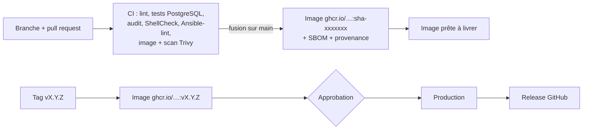

# Chaîne DevOps de Multipressing



## 1. Organisation du code (trunk-based)
- `main` est toujours déployable. On travaille dans une branche courte, puis on ouvre une pull request.
- La CI doit être verte avant la fusion (règle de protection de branche, voir plus bas).
- Les messages de commit suivent la convention `type: description` : `feat:`, `fix:`, `chore:`, `docs:`, `ci:`, `refactor:`.
- Une **release** est un tag `vMAJEUR.MINEUR.CORRECTIF`, par exemple `v1.3.0`. Le tag déclenche le déploiement en production après votre approbation.

```bash
git tag -a v1.3.0 -m "v1.3.0" && git push origin v1.3.0
```

## 2. Ce que vérifie la CI (`pipelines/ci.yml`)

| Contrôle | Outil |
|---|---|
| Style et erreurs JavaScript | ESLint |
| Tests d'intégration sur une vraie base PostgreSQL 16 | `node --test` |
| Vulnérabilités des dépendances | `npm audit` |
| Scripts shell | ShellCheck |
| Script de déploiement : succès, retour arrière, migration en échec | `test/deploy/test-deploy.sh` (Docker simulé) |
| Fichier Compose | `docker compose config` |
| Configuration et alertes Prometheus | `promtool` |
| Rôles Ansible | ansible-lint (profil production) |
| Secrets Ansible chiffrés | vérification de l'en-tête `$ANSIBLE_VAULT` |
| Image Docker : démarrage et vulnérabilités | Trivy (critiques et élevées) |

## 3. Livraison (`pipelines/cd.yml`)
- **Fusion sur `main`** : l'image `ghcr.io/<compte>/multipressing:sha-xxxxxxx` est publiée avec son SBOM et une attestation de provenance. Elle est prête, mais **rien n'est déployé** : avec un seul VPS, c'est le tag de version qui met en production. Un serveur de staging peut être ajouté plus tard (variable `STAGING_ENABLED=true`) : chaque fusion y serait alors déployée automatiquement.
- **Tag `vX.Y.Z`** : l'image `:vX.Y.Z` est publiée, puis **déployée en production après approbation**. La release GitHub est créée avec les notes de version.
- **Lancement manuel** (onglet Actions, workflow CD, « Run workflow ») : redéploie un tag existant dans l'environnement choisi. C'est le **retour arrière en un clic**.

### Le déploiement sur le serveur (`deploy/deploy.sh`)
1. Téléchargement de l'image. En cas d'échec, rien n'est modifié.
2. **Sauvegarde vérifiée** de la base.
3. **Migrations**, avec la nouvelle image et avant le remplacement de l'application. En cas d'échec, l'application en place continue de tourner.
4. Remplacement de l'application. Caddy met les requêtes en attente pendant les quelques secondes de redémarrage, donc pas d'erreur visible pour les utilisateurs.
5. Contrôle de santé : `/healthz` doit répondre avec **la version attendue**.
6. Si le contrôle échoue : **retour automatique** à la version précédente.

**Règle pour les migrations :** une migration doit rester compatible avec la version précédente du code, pour qu'un retour arrière reste possible. On ajoute des colonnes ou des tables ; on ne supprime ou ne renomme qu'à la version suivante (principe « expand / contract »). Les migrations se trouvent dans `src/migrations/NNN_description.sql` et ne sont jamais modifiées une fois en production.

## 4. Infrastructure as Code (`ansible/`)
Le playbook prépare un VPS Ubuntu vierge et peut être rejoué sans risque :
- **base** : mises à jour (y compris les mises à jour de sécurité automatiques), fuseau horaire, fichier d'échange, utilisateur `deploy` connecté par clé uniquement, SSH durci (pas de root, pas de mot de passe), pare-feu UFW (22, 80, 443), fail2ban ;
- **docker** : Docker Engine et Compose depuis le dépôt officiel, rotation des journaux ;
- **app** : `/opt/multipressing`, fichier `.env` généré depuis le vault chiffré, Compose, Caddy, scripts, supervision.

## 5. Mise en place, étape par étape

### a. Le serveur
Préparez Ansible :

```bash
cd ansible && cp inventory/hosts.example.yml inventory/hosts.yml
```

Indiquez l'adresse IP du VPS dans `inventory/hosts.yml`, puis votre domaine et votre image (`ghcr.io/<compte>/multipressing`) dans `inventory/group_vars/*/vars.yml` et `inventory/group_vars/all.yml`.

Créez le fichier de secrets de production :

```bash
cp vault.example.yml inventory/group_vars/production/vault.yml
```

Remplissez-le, puis chiffrez-le :

```bash
ansible-vault encrypt inventory/group_vars/production/vault.yml
```

Installez les collections Ansible :

```bash
ansible-galaxy collection install -r requirements.yml
```

Premier passage, en root :

```bash
ansible-playbook playbooks/site.yml --limit production --ask-vault-pass
```

Les passages suivants se font avec l'utilisateur `deploy`, car root est désactivé :

```bash
ansible-playbook playbooks/site.yml --limit production --ask-vault-pass -e ansible_user=deploy
```

### b. La clé de déploiement de GitHub Actions
Créez une clé dédiée sur votre ordinateur :

```bash
ssh-keygen -t ed25519 -f ~/.ssh/multipressing-deploy -C github-actions-deploy -N ""
```

Ajoutez la clé publique (`~/.ssh/multipressing-deploy.pub`) à **`deploy_ci_keys`** (et non à `deploy_authorized_keys`) dans `inventory/group_vars/all.yml`, puis rejouez le playbook. Sur le serveur, cette clé est limitée par une commande forcée : elle ne peut lancer que le déploiement ou le retour arrière (voir `deploy/ssh-gate.sh`). Même si elle fuitait, elle ne donnerait aucun shell sur le serveur.

Récupérez l'empreinte du serveur :

```bash
ssh-keyscan -t ed25519 ADRESSE_IP_DU_VPS
```

### c. Les réglages GitHub (dépôt, puis Settings)
1. **Environments**, puis créez `production` :
   - *Required reviewers* : vous-même (production uniquement) ;
   - *Deployment branches and tags* : tags `v*` uniquement ;
   - **Secrets** : `DEPLOY_SSH_KEY` (contenu de `~/.ssh/multipressing-deploy`) et `DEPLOY_KNOWN_HOSTS` (résultat de `ssh-keyscan`) ;
   - **Variables** : `DEPLOY_HOST` (IP), `DEPLOY_USER` (`deploy`), `APP_DOMAIN` (domaine).
2. **Variables du dépôt** : rien à créer avec un seul VPS (`STAGING_ENABLED` ne sert que si vous ajoutez un jour un serveur de staging).
3. **Branches**, puis une règle sur `main` : pull request obligatoire, contrôles « Lint, tests, audit », « Scripts, Compose, supervision, Ansible » et « Image Docker et scan de vulnérabilités » obligatoires, pas de push forcé.
4. **Code security** : activez Dependabot (alertes et mises à jour de sécurité) et le secret scanning.

### d. La première version
Poussez le code sur `main` (la CI tourne et l'image est publiée), puis créez le tag :

```bash
git tag -a v1.0.0 -m "Première version" && git push origin v1.0.0
```

Approuvez le déploiement dans l'onglet Actions. Ensuite, créez le compte administrateur sur le serveur :

```bash
ssh deploy@ADRESSE_IP_DU_VPS
```

```bash
cd /opt/multipressing && docker compose exec app node src/scripts/create-admin.js --email vous@exemple.com --name "Votre nom"
```

## 6. Observabilité
- **Journaux** : JSON, une ligne par événement, avec un identifiant de requête (`reqId`, renvoyé dans l'en-tête `X-Request-Id`). Les journaux Docker tournent automatiquement (10 Mo × 5 fichiers).

```bash
docker compose logs -f app | jq 'select(.level=="error")'
```

- **Métriques** : port interne 9464, jamais exposé. Elles couvrent la durée des requêtes par route et statut, la version en ligne, le pool PostgreSQL, les tickets créés par boutique, les encaissements par mode de paiement, les échecs de connexion et les écarts de caisse.
- **Supervision** (Prometheus, Grafana, node-exporter) :

```bash
docker compose --profile monitoring up -d
```

Grafana n'est accessible que par un tunnel SSH. Ouvrez le tunnel, puis allez sur `http://localhost:3001` (tableau de bord « Multipressing — production ») :

```bash
ssh -L 3001:127.0.0.1:3001 deploy@ADRESSE_IP_DU_VPS
```

- **Alertes** (`monitoring/prometheus/alerts.yml`) : application indisponible, plus de 5 % d'erreurs serveur, lenteurs, tentatives de connexion suspectes, pool saturé, disque plein, mémoire faible. Pour être prévenu par e-mail ou Telegram, configurez un point de contact dans Grafana (Alerting, Contact points).
- **Sonde externe** (recommandée, gratuite) : un service comme UptimeRobot ou Better Stack qui interroge `https://VOTRE-DOMAINE/healthz` chaque minute. Il vous prévient même si le serveur entier est tombé.

## 7. Sauvegardes
- Chaque nuit, et avant chaque déploiement, la base est sauvegardée, chiffrée en AES-256, puis **relue et vérifiée**. Elle est conservée 30 jours.
- **Copie hors du serveur** : renseignez `vault_rclone_remote` et les accès d'un stockage compatible S3 (Backblaze B2, Scaleway, OVH, Wasabi). Chaque sauvegarde y est alors envoyée.
- La date de la dernière sauvegarde réussie est dans `backups/.last-success`.
- Faites une restauration d'essai une fois par trimestre, en suivant le [runbook](RUNBOOK.md#restaurer-une-sauvegarde).

## 8. Paiement en ligne (un compte par boutique)
Chaque boutique ouvre **ses propres** comptes marchands et les configure dans « Règles de la boutique », section Paiement en ligne. L'argent arrive sur ses comptes à elle. Une boutique peut activer un seul fournisseur, ou les deux.

### Wave Business (paiements Wave, frais les plus bas)
1. Ouvrez un compte **Wave Business** pour la boutique. Wave demande généralement le NINEA et le registre de commerce.
2. Dans le portail développeur de Wave Business, créez une **clé API** avec le droit Checkout. Si Wave impose une liste d'adresses IP autorisées, ajoutez-y l'adresse fixe du VPS.
3. Déclarez un **webhook** avec l'adresse affichée dans l'application, `https://VOTRE-DOMAINE/api/webhooks/wave/<boutique>`, et l'événement `checkout.session.completed`. Notez le **secret** du webhook.
4. Dans l'application, sur la carte **Wave Business**, collez la clé API et le secret, cochez « Activer ce compte », puis enregistrez.

### PayDunya (Orange Money, Free Money / Mixx, carte bancaire, Wave)
1. Ouvrez un compte **PayDunya** pour la boutique et créez une **application d'intégration** (« Integration setups »). Activez-y les moyens de paiement voulus.
2. Récupérez les trois identifiants : **Master Key**, **Private Key** et **Token**. Ils existent en version test et en version production.
3. Dans l'application, sur la carte **PayDunya** :
   - choisissez l'environnement **Sandbox** pour les essais, ou **Production** ;
   - cochez les moyens à proposer aux clients ;
   - collez les trois identifiants, cochez « Activer ce compte », puis enregistrez.
4. Rien à déclarer chez PayDunya : l'adresse de notification (IPN) lui est envoyée avec chaque paiement.
5. **Avant la production**, faites un paiement de bout en bout **en sandbox** pour chaque moyen coché, pour confirmer les noms de canaux PayDunya utilisés (`orange-money-senegal`, `free-money-senegal`, `wave-senegal`, `card`).

### Validation
Faites un premier paiement réel de 100 FCFA par moyen de paiement. Vérifiez qu'il apparaît dans le ticket et sur le compte marchand de la boutique.

### Choix du fournisseur pour Wave
Si Wave est actif à la fois en direct (Wave Business) et dans PayDunya, l'application utilise **Wave Business en direct**, qui prélève moins de frais.

### Mode test
En local (`compose.local.yml`), activez la carte « Mode test » pour essayer tout le parcours sans argent réel. Ce mode est refusé en production. Un vrai compte actif passe toujours avant lui.

La page de test imite un vrai paiement :
- le client saisit son numéro, puis son code secret : **1234** est accepté ;
- un numéro finissant par **0000** simule un solde insuffisant ;
- trois codes faux refusent le paiement.

Une fois le paiement accepté, le simulateur envoie une **notification signée** à l'application, comme Wave. L'application vérifie la signature, relit l'état du paiement et contrôle le montant avant de l'enregistrer. Dans le ticket, chaque paiement en ligne affiche ensuite sa preuve : fournisseur, date, mode de vérification et référence de la transaction.
